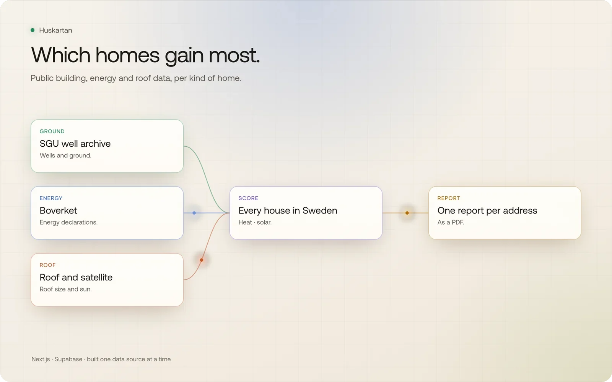
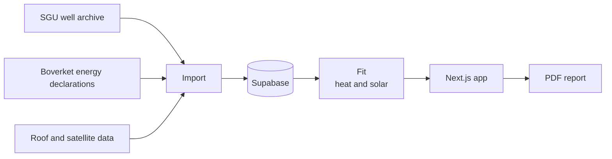

# Huskartan

Shows which kinds of Swedish homes gain most from a new heating system or solar, from public building, energy and roof data. The code is private, so this is a short write-up.

<picture><source media="(prefers-color-scheme: dark)" srcset="assets/huskartan.webp"></picture>

It looks at two things:

| Part | Question |
|---|---|
| Heat | How much could this house gain from a new heating system? |
| Solar | How good is the roof? |

Data comes from the SGU well archive, Boverket's energy declarations and roof and satellite data.

I built it one data source at a time over a series of sessions.

Stack: Next.js, Supabase.

More on how I work: [github.com/johanmatsgard](https://github.com/johanmatsgard#how-i-work)
